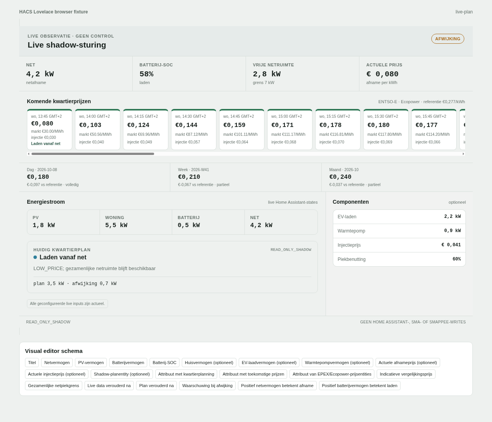

# Dynamic Energy Shadow Dashboard

Home Assistant Lovelace package with two deliberately separate cards:

- `dynamic-energy-shadow-card`: the stable read-only monitor for live energy
  values and a proposed Day-Ahead battery shadow plan;
- `dynamic-energy-control-config-card`: an alpha configuration surface limited
  to namespaced, hard-blocked Home Assistant automations.

The monitoring card never calls Home Assistant actions. The alpha control card
can create or switch only its own automations between `OFF` and
`ARMED_BLOCKED`. It cannot select `LIVE`, and generated automations stop before
any SMA, Smappee, battery or EV-charger action.



## Features

- live grid, PV, battery and SOC values;
- optional house, EV, heat-pump and price entities;
- configurable shared grid-import limit and remaining headroom;
- current shadow-plan action, reason and planned-versus-actual deviation;
- upcoming quarter-hour market and tariff prices, compared with
  the indicative `€0.277/kWh` reference and aligned with planned actions;
- previous/next navigation that keeps its position across Home Assistant state
  refreshes;
- a responsive full-day quarter-price graph, including elapsed intervals and
  daylight-saving days with 92 or 100 quarters, bounded to the three latest
  local price days;
- visible missing, unavailable and stale-data states;
- visual editor for entity mapping and thresholds;
- responsive light/dark Home Assistant styling;
- no runtime dependencies.

Alpha `0.3.0-alpha.4` also adds:

- a separate visual editor for battery/EV dry-run settings;
- explicit confirmation before Home Assistant configuration changes;
- ownership checks for the `dynamic_energy_battery_v1` and
  `dynamic_energy_ev_v1` automation IDs;
- a deterministic canonical configuration snapshot that detects changes made
  after the card generated an automation;
- fail-closed conflict handling when an automation is foreign, modified or
  mapped to multiple entities;
- only `OFF` and `ARMED_BLOCKED`, with `execution_allowed: false` embedded in
  every managed automation;
- a data-dense control overview with current, cheapest and highest upcoming
  prices, current shadow action and live battery/grid/EV context;
- independent read-only price-entity freshness, so current and upcoming
  Ecopower prices remain visible when the shadow plan is stale;
- a separate `PRICE_READY_PLAN_BLOCKED` state that keeps price context visible
  without implying that a stale plan may be executed;
- explicit controller ownership and a separate setup guide for SMA battery and
  Smappee EV configuration;
- an explicit Smappee dynamic-tariff status that defaults to `NOT_VERIFIED` and
  never treats Smappee Smart mode as proof that dynamic tariffs are active;
- visible warnings when the shared dashboard limit and the Smappee capacity
  threshold differ;
- reliable quarter-price navigation and a daily graph that does not require
  horizontal scrolling.

## Install with HACS

A committed GitHub revision or release is required before HACS can install the
artifact. No publication is performed automatically by this repository.

1. Open HACS in Home Assistant.
2. Open the three-dot menu and choose `Custom repositories`.
3. Select `Add custom repository`.
4. Enter the GitHub repository URL.
5. Select repository type `Dashboard`.
6. Install `Dynamic Energy Shadow Dashboard`.
7. Refresh the browser when HACS requests it.

The alpha control card requires Home Assistant `2024.10.0` or newer because its
generated automations use the current plural automation syntax.

For the alpha control card, explicitly select the `0.3.0-alpha.4` prerelease in
HACS. Do not replace a stable read-only installation with the alpha unless the
Home Assistant configuration-write boundary below is understood.

## Configure through the GUI

1. Open or create a Lovelace dashboard.
2. Choose `Edit dashboard` and then `Add card`.
3. Select `Dynamic Energy Shadow Dashboard` from the card picker.
4. Use the visual editor to select the live entities and thresholds.

Recommended live mappings:

- grid power: signed grid power sensor;
- PV power: current PV generation;
- battery power: signed charge/discharge power;
- battery SOC: current percentage;
- optional house, EV and heat-pump power;
- optional current import and export price;
- optional plan entity containing the generated shadow schedule.

### Optional Home Assistant price integrations

The two supported frontend price inputs are:

1. a fresh shadow entity with validated `prices`, optional `price_aggregates`
   and source/tariff metadata attributes;
2. fresh `EPEX Spot Data` / `Ecopower Dynamic Prices` entities.

The card can also build the future timeline directly from Home Assistant price
entities whose `data` attribute contains `start_time`, `end_time` and
`price_per_kwh` rows. This contract is provided by the HACS integrations
`EPEX Spot Data` and `Ecopower Dynamic Prices`. Identical duplicate intervals
from these integrations are collapsed; conflicting duplicates remain rejected.

Recommended setup when those integrations are already available:

1. Install and configure `EPEX Spot Data` for Belgium through HACS.
2. Install `Ecopower Dynamic Prices` through HACS.
3. In the Ecopower integration, select the EPEX Spot sensor as `price_source`.
4. Select the Ecopower consumption sensor as `Actuele afnameprijs` in the card.
5. Select the Ecopower injection sensor as `Actuele injectieprijs`.
6. Keep `Attribuut van EPEX/Ecopower-prijsentities` set to `data`.
7. Keep the indicative comparison price at `0.277 EUR/kWh`, unless the owner
   deliberately changes that benchmark.

This is optional. The card selects one coherent source. It uses the fresh valid
source with the better upcoming interval coverage, so one partial shadow row does
not suppress a complete integration timeline. The price integrations remain
read-only inputs and do not create battery, inverter or charger controls.

The GUI supports sign conventions because integrations differ: grid import can
be positive or negative, and battery charging can be positive or negative.

## Alpha control configuration card

Add this card separately from the read-only monitor:

```yaml
type: custom:dynamic-energy-control-config-card
title: Dynamic Energy configuratie
name_prefix: Dynamic Energy
plan_entity: sensor.dynamic_energy_shadow_plan
interval_minutes: 15
peak_limit_kw: 7
battery_enabled: true
battery_reserve_soc_percent: 10
ev_enabled: true
ev_target_soc_percent: 80
ev_departure_time: "07:00:00"
battery_soc_entity: sensor.battery_soc
grid_power_entity: sensor.grid_power
grid_import_positive: true
ev_power_entity: sensor.ev_power
import_price_entity: sensor.ecopower_dynamische_tarieven_market_price_consumption_price
export_price_entity: sensor.ecopower_dynamische_tarieven_market_price_injection_price
integration_price_attribute: data
price_stale_after_minutes: 20
data_stale_after_minutes: 10
plan_stale_after_hours: 30
sma_controller: Sunny Home Manager 2.0
sma_optimization_goal: Economisch
sma_tariff_type: Dynamisch · Day-Ahead · BE · EPEX Spot
sma_forecast_charging: OFF
sma_grid_charge_soc_percent: 0
sma_feed_in_eur_per_kwh: 0.02
smappee_mode: smart
smappee_grid_connection: Driefasig – Delta · 2 × 40 A
smappee_capacity_threshold_kw: 5.5
smappee_max_current_ampere: 32
smappee_offline_fallback_ampere: 8
smappee_dynamic_tariff_status: NOT_VERIFIED
```

The card has three confirmed actions:

1. create or update only its namespaced blocked automations;
2. enable verified automations as `ARMED_BLOCKED`;
3. disable existing verified managed automations as `OFF`.

Before every write, the card verifies ownership. Creation and updates also ask
Home Assistant to validate the trigger, condition and stop action. Enable and
disable actions instead re-read and verify the exact sealed configuration. The
generated action is only a safety stop. It contains no inverter, battery,
charger, MQTT or other actuator service call. Existing automations without the
management marker, with a changed stop action or with ambiguous entity mappings
are rejected.

The embedded snapshot is an exact consistency seal, not cryptographic
authentication. Normal Home Assistant or manual edits invalidate the seal; an
external tool that deliberately replaces both the automation and its canonical
snapshot is outside this ownership check. A changed automation must normally be
recreated through the card before it can be enabled again.

This alpha does perform bounded Home Assistant configuration writes when the
user explicitly confirms a button action. Those writes create/update or toggle
only the two managed automation IDs above. Installing the alpha alone performs
no write, and the read-only shadow card remains observation-only.

### SMA batterijconfiguratie

The control panel presents the intended installation profile; it does not apply
these values. Keep **one active controller per actuator**. With SMA as battery
owner, Home Assistant remains an observer and blocked dry-run surface.

Recommended staged profile for a Sunny Home Manager 2.0 installation:

1. Set the optimization objective to `Economisch`.
2. Select a dynamic Day-Ahead tariff for region `BE` with the supported EPEX
   Spot source and confirm that quarter-hour prices are visible.
3. Keep the dynamic grid-charging SOC setting at `0%` where required by the
   SMA forecast-charging workflow.
4. Treat a fixed feed-in value such as `€0.02/kWh` only as a conservative SMA
   planning proxy; calculate the real supplier formula outside SMA.
5. Leave forecast-based charging `OFF` until its schedule has been compared
   with the shadow plan over representative days in a controlled pilot.
6. Keep peak shaving off unless it receives a separate shared-limit and
   controller-ownership validation.
7. Do not enable competing Home Assistant or Modbus battery setpoints while SMA
   is the active controller.

Primary SMA references:

- [Planning forecast-based battery charging](https://manuals.sma.de/HM-20-ennexOS/en-US/12563269899.html)
- [Configuring electricity tariffs](https://manuals.sma.de/HM-20-ennexOS/nl-NL/11412423819.html)
- [Sunny Home Manager product information](https://www.sma.de/en/products/energy-management/sunny-home-manager)

### Smappee EV-configuratie

Keep Smappee as the local EV and overload-protection owner. The dashboard can
explain price windows, but it must not become a second charger scheduler.

Recommended staged profile:

1. Use `Smart` mode when local overload protection and capacity control are the
   priority. Select `Solar` only deliberately for PV-surplus charging.
2. Verify that the configured grid topology and current rating exactly match
   the physical installation; these are safety inputs, not price preferences.
3. Keep the charger current at or below the validated installation and device
   maximum.
4. Keep the Smappee capacity threshold as the EV-specific limit. If it is lower
   than the dashboard's shared grid limit, the stricter Smappee value wins.
5. Keep offline charging disabled until the fallback current and physical
   installation have been validated. If offline operation is later enabled,
   treat it as degraded operation because automatic overload protection is not
   guaranteed there.
6. Use only one session scheduler: Kia, Smappee or a future approved external
   controller, never several at the same time.
7. Treat Smappee dynamic-tariff displays as planning context unless all supplier
   surcharges and charges have been reconciled separately.
8. Leave `smappee_dynamic_tariff_status` at `NOT_VERIFIED` unless a separate,
   readable and trustworthy status source proves the setting. `Smart` charging
   mode alone does not prove that dynamic tariffs are active.

Primary Smappee references:

- [Charging modes and schedules](https://support.smappee.com/hc/en-gb/articles/4900468508692)
- [Smart Charging](https://support.smappee.com/hc/en-gb/articles/4406735969940)
- [EV Wall Home](https://support.smappee.com/hc/en-gb/articles/4402413229844-EV-Wall-Home)

The card performs no SMA- or Smappee-setting change. Device configuration must
still be applied and verified in the vendor interface by the owner or installer.

## Plan entity contract

The optional observer entity should expose attributes named `schedule` and
`prices` by default. Price visibility does not depend on a valid battery plan:
`prices` remains populated when the plan state is `NO_ACTION`.

The `schedule` attribute is a list of quarter-hour objects:

```yaml
schedule:
  - start_utc: "2026-10-02T10:15:00+00:00"
    duration_hours: 0.25
    action: CHARGE_FROM_GRID
    reason: LOW_PRICE; shared-grid headroom remains
    planned_grid_import_kw: 3.5
    planned_grid_export_kw: 0
    charge_kwh: 0.25
    discharge_kwh: 0
```

The attribute name can be changed in the visual editor. Missing or stale plan
data remains visible and does not trigger a guessed action.

The `prices` attribute contains privacy-safe public market and tariff values:

```yaml
prices:
  - start_utc: "2026-10-02T10:15:00+00:00"
    duration_hours: 0.25
    market_eur_per_mwh: 80.0
    import_eur_per_kwh: 0.105
    export_eur_per_kwh: 0.064
price_source: Example validated shadow feed
price_tariff_version: ECOPOWER_DBS_2026-08-01
```

The observer feed also supplies compact `price_aggregates` for the latest day,
ISO week and month. Partial periods remain explicitly labelled in the card.
The visual-editor value `price_reference_eur_per_kwh` is authoritative; the card
recomputes displayed aggregate differences from that configured reference.

This public repository contains the frontend card only. It does not retrieve
ENTSO-E data, run a pricing backend or provide a REST-sensor deployment path.

## Manual YAML fallback

The visual editor is the default. YAML remains available for troubleshooting:

```yaml
type: custom:dynamic-energy-shadow-card
title: Shadow-sturing
grid_power_entity: sensor.grid_power
pv_power_entity: sensor.pv_power
battery_power_entity: sensor.battery_power
battery_soc_entity: sensor.battery_soc
plan_entity: sensor.shadow_plan_placeholder
plan_attribute: schedule
price_attribute: prices
integration_price_attribute: data
price_reference_eur_per_kwh: 0.277
peak_limit_kw: 7
stale_after_minutes: 10
grid_import_positive: true
battery_charge_positive: true
```

## Development validation

```bash
python3 -m unittest tests.test_hacs_lovelace_package -v
npm run test:hacs
npm run check:hacs
```

The HACS artifact is `dist/dynamic-energy-dashboard.js`.

Release validation for the alpha is documented in
`docs/releases/v0.3.0-alpha.3-checklist.md`.
